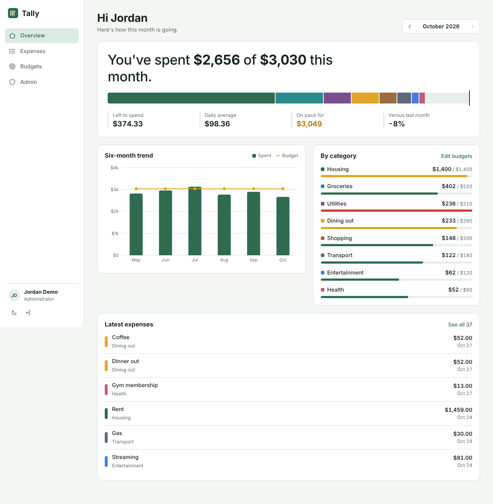
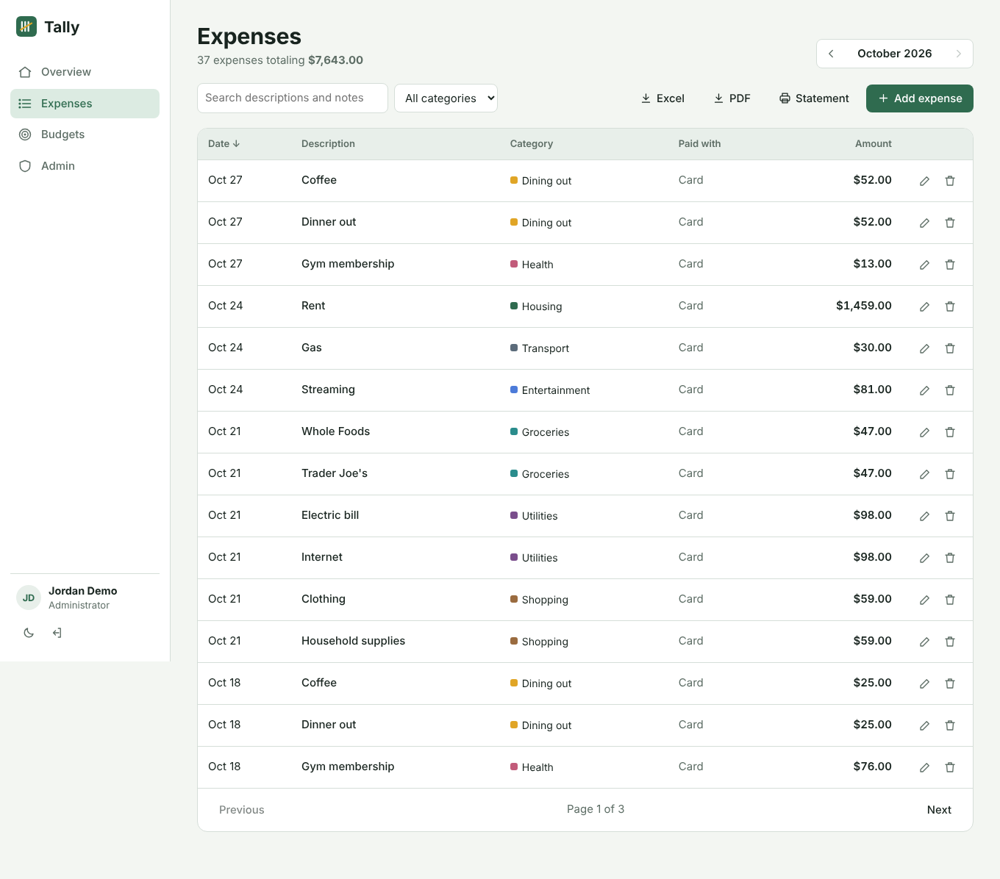
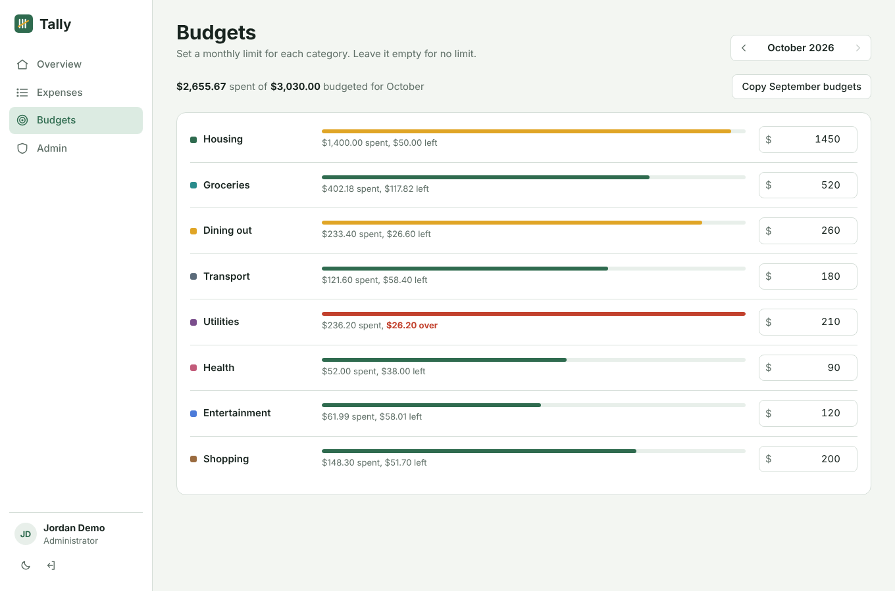
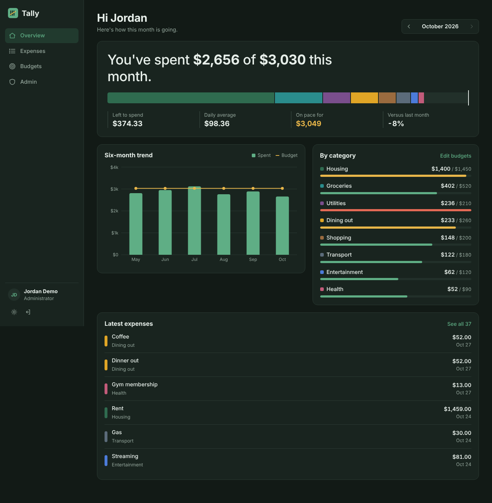
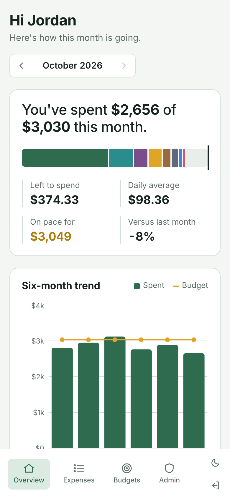

# Tally

A personal expense and budget tracker. You log what you spend, set a monthly limit for each category, and the overview tells you how the month is going and where it's heading.

**Live demo:** https://YOUR-APP.azurewebsites.net (click "Open the demo" on the sign-in page, no account needed)



## Features

- Sign up / sign in with JWT auth, two roles (User and Admin)
- Add, edit, delete and search expenses, filter by category and month, sort and page through results
- Monthly budgets per category with progress bars, overspend warnings and "copy last month"
- Overview page with total spent vs budget, daily average, projected month-end spend, a six-month trend chart and a per-category breakdown
- Export a date range to Excel (two sheets, with totals and filters) or PDF
- Printable monthly statement rendered on the server with an MVC Razor view
- Admin area to promote/demote users and manage shared categories (archive instead of delete so history stays intact)
- Light and dark theme, works on phones (bottom tab bar on small screens)
- Demo accounts seeded with six months of sample data

| Expenses | Budgets |
| --- | --- |
|  |  |

| Dark theme | Mobile |
| --- | --- |
|  |  |

## Tech stack

**Backend:** ASP.NET Core (.NET 10), MVC controllers, Entity Framework Core with SQLite, ASP.NET Core Identity, JWT bearer auth, ClosedXML (Excel), QuestPDF (PDF), OpenAPI with Scalar docs

**Frontend:** React 19, TypeScript, Vite, React Router, Recharts, plain CSS (no UI library)

**Testing and delivery:** xUnit (unit + integration tests with `WebApplicationFactory`), Vitest, GitHub Actions, Azure App Service, Docker

## Architecture

```
React SPA (Vite)
   │  fetch + Bearer token
   ▼
ASP.NET Core
   ├── API controllers   /api/auth, /api/expenses, /api/budgets, /api/dashboard, /api/reports, /api/admin
   ├── MVC controller    /statement/{year}/{month}  -> Razor view
   ├── Services          ExpenseService, BudgetService, DashboardService, ReportService, TokenService
   └── EF Core           AppDbContext (Identity + Expenses, Budgets, Categories) -> SQLite
```

In production the API also serves the built React app from `wwwroot`, so the whole thing deploys as one App Service app.

A few decisions worth mentioning:

- **Controllers stay thin.** They read the user id from the token and call a service. Business rules live in the services, which is also what the unit tests target.
- **Every query is scoped to the signed-in user.** Asking for someone else's expense returns 404 rather than 403, so the API doesn't confirm the id exists.
- **Money in SQLite.** SQLite can't sum or sort `decimal` columns, so amounts are stored as `double` through an EF value converter and rounded to cents when saved. On SQL Server or Postgres I would map them to a proper decimal column.
- **Categories are archived, not deleted,** so old expenses and reports keep their category.
- **Errors** go through one `IExceptionHandler` that returns RFC 7807 problem details, and the frontend shows the `detail` message.

## Running it locally

You need the [.NET 10 SDK](https://dotnet.microsoft.com/download) and [Node 22+](https://nodejs.org).

```bash
# terminal 1 - API on http://localhost:5080
cd backend/src/Tally.Api
dotnet run

# terminal 2 - React app on http://localhost:5173
cd frontend
npm install
npm run dev
```

Open http://localhost:5173. The database file (`tally.db`) is created and seeded on first run. API docs are at http://localhost:5080/api-docs.

Demo logins:

| Role | Email | Password |
| --- | --- | --- |
| User | demo@tally.dev | Demo123! |
| Admin | admin@tally.dev | Admin123! |

### Tests

```bash
cd backend && dotnet test
cd frontend && npm test
```

### Docker

```bash
docker build -t tally .
docker run -p 8080:8080 -e Jwt__Key="any-random-string-at-least-32-characters" tally
```

Then open http://localhost:8080.

## Deployment

GitHub Actions builds and tests both projects on every push and pull request. When `main` passes, a deploy job builds the React app, publishes the API with the React build in `wwwroot`, and deploys it to Azure App Service (Linux, free F1 plan) using a publish profile stored as a GitHub secret.

App settings on Azure:

| Setting | Value |
| --- | --- |
| `Jwt__Key` | a random string of 32+ characters (never in the repo) |
| `ConnectionStrings__Default` | `Data Source=/home/data/tally.db` |

`/home` is persistent storage on App Service, so the database survives restarts and deploys. The free plan sleeps when idle, so the first request after a while takes a few seconds.

## What I'd add next

- EF Core migrations and a hosted Postgres database instead of SQLite
- Recurring expenses (rent, subscriptions) that post automatically
- Refresh tokens instead of a single two-hour token
- CSV import from a bank export
